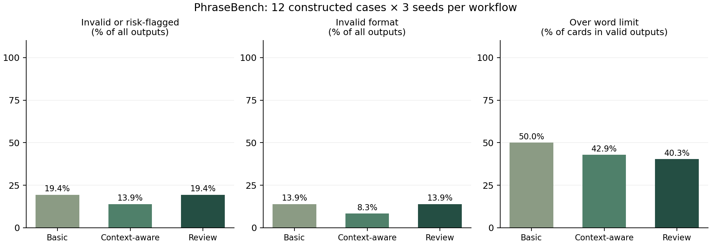
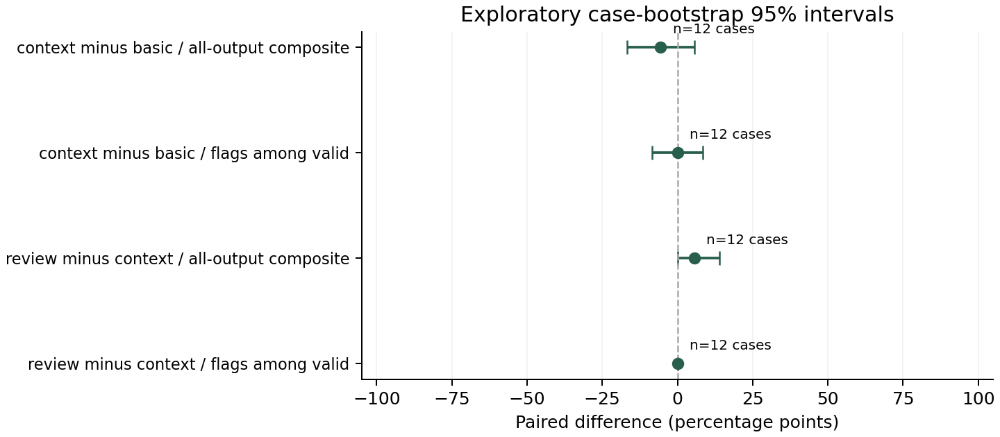

# PhraseBench: a constructed-case evaluation of communication-suggestion prompting

Technical report · 8 September 2026 · Benchmark v1.0.0

## Abstract

We evaluated basic prompting, explicit context-aware prompting, and a subsequent structured-review pass using a pinned local Qwen3.5-0.8B Q8_0 model. Twelve original English fictional cases across six domains were each evaluated with three fixed seeds, producing 108 actual model calls and 36 final outputs per condition. Output format, lexical consistency-risk flags, exact duplicates, word limits and resource use were measured with frozen rules. Valid outputs numbered 31/36, 33/36 and 31/36 for basic, context and review respectively. The prespecified audit found unsupported assumptions and output-role mismatches that survived review; one reviewed set regressed from six cards to four. The automatic risk flags missed several of these problems. These constructed-case results do not establish communication usefulness or benefit for people.

## 1. Motivation and relationship to prior work

The earlier project concerned whether an adult review interface improves preparation of supplemental communication materials. This autonomous experiment examines model prompting, not that human-interface effect. The closest inspected authoring study used fictional cases to compare AI-assisted VSD creation with Snap Scene and reported mixed quality alongside efficiency gains ([Zastudil et al., ASSETS 2025](https://arxiv.org/html/2507.21811v1)). Personalization and review are not claimed as new categories. [Frisch et al.'s 2026 workshop paper](https://arxiv.org/html/2606.24854v1) argues for evaluation beyond narrow technical measures; our limited proxies must be interpreted accordingly.

## 2. Methods

The prerequest specification is in docs/protocol.md and data/frozen-manifest.json. All public case information is shared across conditions; private annotations are excluded. Basic uses a short generation instruction. Context adds explicit grounding, uncertainty, nonrepetition and communication-function instructions. Review consumes the exact context output plus the same case in a fresh request. Context drafts are reused, making review a paired extension rather than a newly regenerated draft. Extra computation and review content are not experimentally separated.

Cases cover crafts, food, music, outdoor activity, social activity and routines. Half request at most three words per card and half eight; all request six optional supplemental cards. Profiles contain preferences, alternatives and uncertainty rather than real participant records. They are original constructed materials, not a population sample or validated communication scenarios.

Model: [Qwen3.5-0.8B](https://huggingface.co/Qwen/Qwen3.5-0.8B), using the [ggml-org GGUF conversion](https://huggingface.co/ggml-org/Qwen3.5-0.8B-GGUF) at revision `8fea620810c4afa23dd6443f999a48574c1611a3`, Q8_0, model SHA256 `37ae482d336108d23516fa35e8e0c4126688d81018b87178a18d752a1357814f`. Runtime: [llama.cpp](https://github.com/ggml-org/llama.cpp) b10853, CPU, two threads, one slot, 4096-token context and disabled reasoning. Temperature 0.7, top_p 0.8, top_k 20, min_p 0, repeat penalty 1, maximum 256 generated tokens. Generation seeds were 17, 29 and 43; review used each seed +1000. A fixed shuffled schedule mixed cases and conditions. Inference used independent chat histories and disabled prompt caching. The smoke test is excluded from results.

Complete request payloads, raw responses, token counts, finish reasons, timings and seeds are retained in results/raw. Malformed, truncated or noncompliant outputs were not repaired or regenerated. The analysis requires all expected record IDs and verifies the frozen input hashes.

## 3. Measurements and analysis

Rule-flagged consistency risks are narrow lexical candidates, not semantic truth labels. Detectors recognize some positive liking assertions about known disliked topics and selected unsupported autobiographical/medical assertions. Negation handling is deliberately simple. Format errors count separately. The all-output composite combines invalid output or a risk flag; a lower value does not guarantee better material. Duplicates normalize case and punctuation. Word-limit violations measure requested-format compliance, not linguistic suitability. Function indicators detect selected words/forms and do not validate communicative intent.

For condition contrasts, the three seeds are averaged within each case; bootstrap intervals resample the cases 10,000 times with seed 20260907. Conditional risk metrics omit undefined pairs and report denominators. Raw output counts remain visible. These exploratory intervals reflect variation across our constructed cases, not general population uncertainty.

## 4. Results

| Workflow | Valid outputs | Risk-flagged / valid | Invalid or risk / all | Duplicate cards | Over-limit cards | Mean workflow seconds |
|---|---|---|---|---|---|---|
| basic | 31/36 | 2/31 | 7/36 | 13 | 93 | 13.9 |
| context | 33/36 | 2/33 | 5/36 | 6 | 85 | 13.8 |
| review | 31/36 | 2/31 | 7/36 | 6 | 75 | 28.0 |

Review workflow time includes its parent context generation. Duplicate and over-limit counts use valid outputs only; they are not comparable without considering those denominators.

- review minus context, flags among valid outputs: +0.0 percentage points; exploratory 95% case-bootstrap interval [0.0, 0.0]; 12 case pairs.
- review minus context, invalid output or a risk flag: +5.6 percentage points; exploratory 95% case-bootstrap interval [0.0, 13.9]; 12 case pairs.
- context minus basic, flags among valid outputs: +0.0 percentage points; exploratory 95% case-bootstrap interval [-8.3, 8.3]; 12 case pairs.
- context minus basic, invalid output or a risk flag: -5.6 percentage points; exploratory 95% case-bootstrap interval [-16.7, 5.6]; 12 case pairs.

An interval of [0, 0] for a conditional contrast reflects identical observed case-level differences under this metric. It does not establish equivalence beyond these constructed cases or compensate for an insensitive detector.

The narrow detector's authored reference set contained 24 cards. Against the benchmark designer's reference interpretation it produced 9 true positives, 1 false positives, 10 true negatives and 4 false negatives (precision 90.0%, recall 69.2%). These are deliberately diagnostic examples with known weaknesses, not an estimate of accuracy on generated material. The tests verify implementation behavior even where the semantic interpretation and rule output differ.

## 5. Inspecting what the rules miss

The prespecified audit found unsupported assumptions and output-role mismatches that survived review; one reviewed set regressed from six cards to four. The automatic risk flags missed several of these problems.

The prespecified audit covers seed 17 in craft-glue, food-unknown, social-story and routine-change across all three conditions. Full findings are in results/audit.json and the dashboard. It was performed by the assistant building this benchmark, with condition visible. It is neither independent expert review nor evidence from human participants. Additional post-hoc examples, if present, are explicitly labeled. Frozen rules were not revised to fit observed outputs.

## 6. Resources and reproducibility

Actual calls: 108. Total measured request wall time: 25.1 minutes. Input tokens: 33,687; output tokens: 8,174. API fees: USD 0 because inference was local; electricity, hardware and development effort were not priced. The model file is 833,592,096 bytes. Observed runtime includes prompt processing and host contention and is not a controlled hardware benchmark.

Run setup_local.py, start the pinned server as described in README.md, and use run.py run, analyze.py, plot_results.py and build_report.py. The saved run can be rescored and its report rebuilt without downloading a model or calling an API. Exact text reproducibility across different hardware/compiler/runtime configurations is not promised by a sampling seed alone. Model/runtime content hashes and all original outputs provide a checkable record.

## 7. Limitations and next experiment

This is one small quantized model, 12 constructed English cases and three seeds. The benchmark designer authored both cases and measurement rules. Review has more computation, and neither automatic flags nor phrase-count compliance establishes usefulness. A zero risk-flag rate cannot establish an absence of hallucination. Some outputs may describe the person or give advice to an adult rather than supply usable first-person choices; no automatic rule fully captures that mismatch. A short-form word limit is an experimental instruction, not a recommendation to restrict a person's vocabulary.

A stronger extension would use independently authored held-out cases, qualified raters, broader semantic assessment and additional models under documented budgets. Any real-user benefit or graphical-review-interface effect requires a separate study. No clinical, universal model-ranking or global-novelty claim is made.
